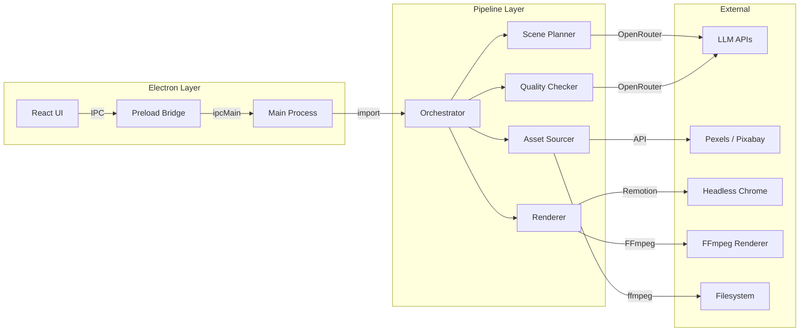

# Architecture

**Electron app** (`src-electron/`) with shared pipeline core (`src/pipeline/`). React UI communicates with main process via IPC.

## System Layers



## Dual Renderer Architecture

The app supports two rendering backends:

| Feature | Remotion | FFmpeg |
|---------|----------|--------|
| Engine | Chrome headless + webpack | Native FFmpeg (spawn) |
| Speed | Slower (browser-based) | Faster (native binary) |
| Cancel support | No | Yes (AbortSignal) |
| Resume support | Segment-level | Beat-level with manifest |
| Session times | No | Yes (tracked per cancel) |
| Chrome dependency | Required | None |

## Key Design Decisions

| Decision | Reason |
|----------|--------|
| All state in App.tsx | No Redux/Zustand — useState hooks only |
| State persistence | `pipeline_state.json` enables resume from any failed step |
| Dual renderer | FFmpeg for speed + cancel support, Remotion for compatibility |
| Promise.allSettled in FFmpeg | Saves progress even when cancelled mid-batch |
| Atomic manifest writes | Write to .tmp then rename — prevents corruption |
| Overlay audio via ffmpeg `amix` | Mixed into VO track (single stream) — QuickTime only plays first audio track |
| Segment rendering | Videos split into configurable segments for reliability on 2+ hour videos |
| Compositor binaries in resources | Bypasses asar read issues with native binaries |
| Monkey-patched `fs.chmodSync` | Handles asar virtual paths in packaged app |

## Cancel/Continue Flow

1. User clicks Stop → `cancel()` sets flag + aborts `AbortController`
2. In-flight FFmpeg processes killed via `SIGTERM`
3. Manifest saved with `elapsedMs` and `sessionTimes[]`
4. User clicks Continue → reads manifest, resumes from last completed beat
5. Session times accumulated across multiple cancel/continue cycles

## Data Flow

```
Script.txt / SRT + VO.mp3
  → Scene Planner (LLM) → ScenePlan (JSON)
  → Asset Sourcer (Pexels/Pixabay API) → AssetMapping {beatId: filePath}
  → Quality Checker (vision LLM) → accepted/rejected lists
  → Renderer (Remotion or FFmpeg) → output.mp4
```

See also: [[Pipeline Flow]], [[Data Model]], [[Packaging]], [[FFmpeg Renderer]]
