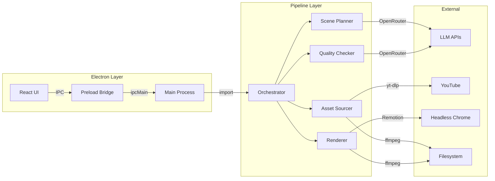

# Architecture

Two modes: **CLI** (`src/index.ts`) and **Electron app** (`src-electron/`). Both share the same pipeline core (`src/pipeline/`).

## System Layers



## Key Design Decisions

| Decision | Reason |
|----------|--------|
| Shared pipeline core | CLI and Electron use identical code |
| State persistence | `pipeline_state.json` enables resume from any failed step |
| Symlink-based asset serving | Avoids copying large video files into webpack bundle |
| Compositor binaries in resources | Bypasses asar read issues with native binaries |
| Monkey-patched `fs.chmodSync` | Handles asar virtual paths in packaged app |
| `process.chdir` for browser download | Remotion's `ensureBrowser` resolves cache dir from cwd |

## Data Flow

```
Script.txt + VO.mp3
  → Scene Planner (LLM) → ScenePlan (JSON)
  → Asset Sourcer (yt-dlp + LLM) → AssetMapping {beatId: filePath}
  → Quality Checker (vision LLM) → accepted/rejected lists
  → Renderer (Remotion) → output.mp4
```

See also: [[Pipeline Flow]], [[Data Model]], [[Packaging]]
