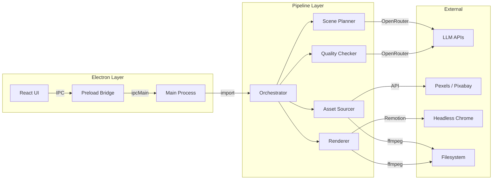

# Architecture

**Electron app** (`src-electron/`) with shared pipeline core (`src/pipeline/`). React UI communicates with main process via IPC.

## System Layers



## Key Design Decisions

| Decision | Reason |
|----------|--------|
| All state in App.tsx | No Redux/Zustand — useState hooks only (37 hooks) |
| State persistence | `pipeline_state.json` enables resume from any failed step |
| `renderMedia({ muted: true })` | Remotion renders video-only; all audio muxed via ffmpeg after |
| Overlay audio via ffmpeg `amix` | Mixed into VO track (single stream) — QuickTime only plays first audio track |
| Segment rendering | Videos split into configurable segments (~30s default) for reliability on 2+ hour videos |
| Compositor binaries in resources | Bypasses asar read issues with native binaries |
| Monkey-patched `fs.chmodSync` | Handles asar virtual paths in packaged app |

## Data Flow

```
Script.txt / SRT + VO.mp3
  → Scene Planner (LLM) → ScenePlan (JSON)
  → Asset Sourcer (Pexels/Pixabay API) → AssetMapping {beatId: filePath}
  → Quality Checker (vision LLM) → accepted/rejected lists
  → Renderer (Remotion segments + ffmpeg mux) → output.mp4
```

See also: [[Pipeline Flow]], [[Data Model]], [[Packaging]]
