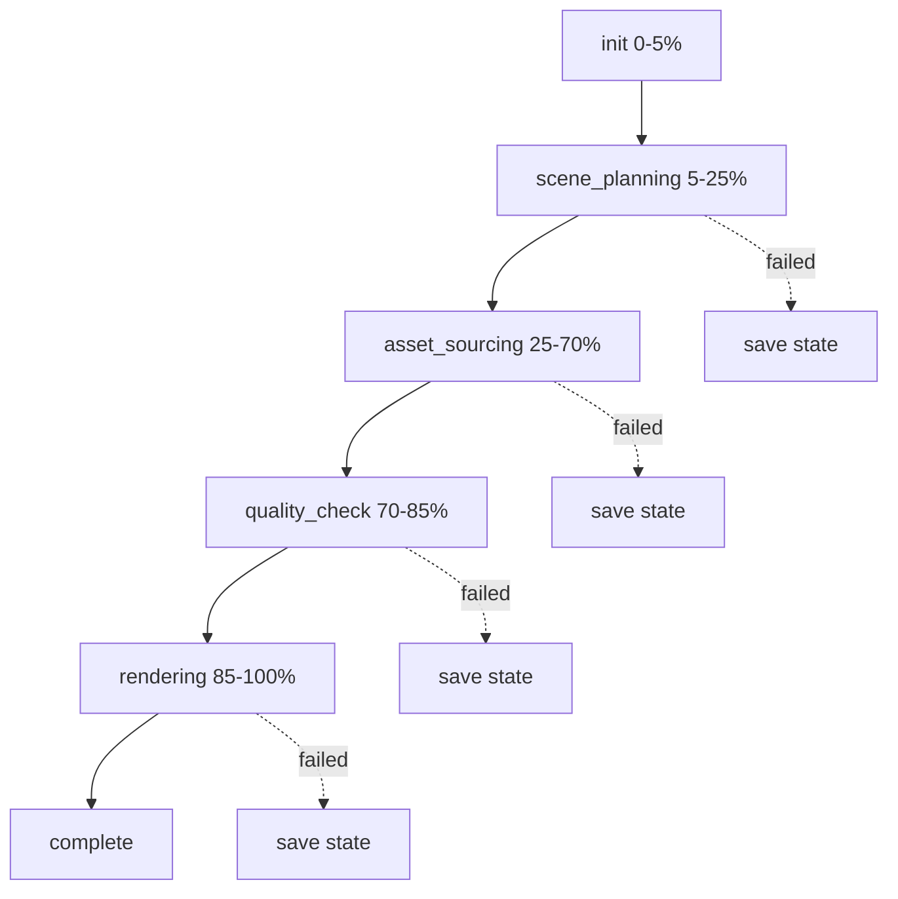

# Pipeline Flow

5-step pipeline controlled by [[Orchestrator]]. Each step is tracked in `pipeline_state.json` for resume.

## Steps

| Step | Input | Output | Tool |
|------|-------|--------|------|
| **init** | scriptPath, voPath | Preflight checks | fs, yt-dlp, ffmpeg |
| **scene_planning** | Script text + VO duration | `ScenePlan` JSON | LLM via [[LLM Client]] |
| **asset_sourcing** | Beat search queries | `AssetMapping` {beatId: filePath} | [[yt-dlp Wrapper]] + LLM vision |
| **quality_check** | Downloaded assets | accepted/rejected lists | LLM vision ([[Quality Checker]]) |
| **rendering** | ScenePlan + assets + VO | Final .mp4 | [[Renderer]] (Remotion) |

## State Persistence

After each step completes, state is saved to `output/pipeline_state.json`:
- `completedSteps[]` — which steps succeeded
- `assets` — downloaded file paths
- `scenePlan` — path to saved scene plan JSON
- `scriptPath`, `voPath`, `musicPath` — original input paths

On resume ([[Orchestrator]]), completed steps are skipped.

See also: [[Orchestrator]], [[Data Model]], [[Configuration]]
