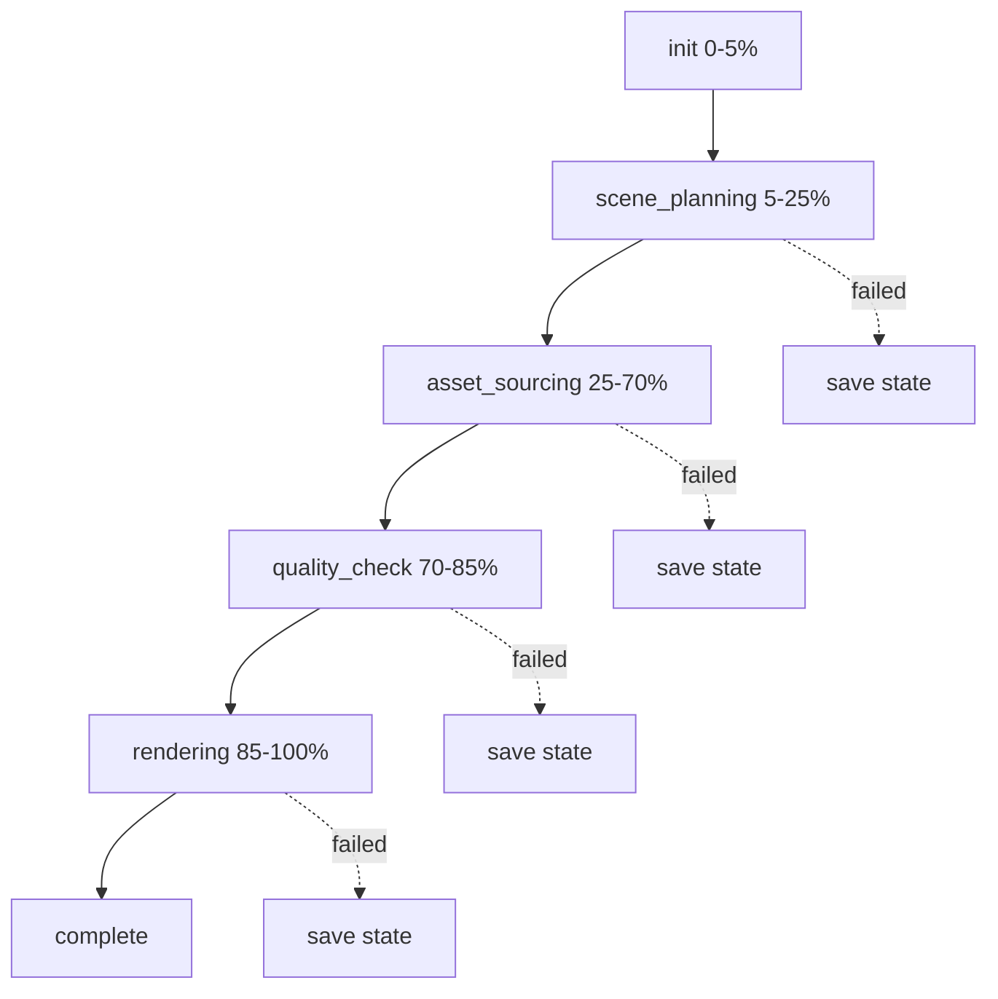

# Pipeline Flow

5-step pipeline controlled by [[Orchestrator]]. Each step is tracked in `pipeline_state.json` for resume.

## Steps

| Step | Input | Output | Tool |
|------|-------|--------|------|
| **init** | scriptPath/SRT, voPath | Preflight checks | fs, ffmpeg |
| **scene_planning** | Script/SRT text + VO duration | `ScenePlan` JSON | LLM via [[LLM Client]] |
| **asset_sourcing** | Beat search queries | `AssetMapping` {beatId: filePath} | [[Asset Sourcer]] (Pexels/Pixabay API) |
| **quality_check** | Downloaded assets | accepted/rejected lists | LLM vision ([[Quality Checker]]) |
| **rendering** | ScenePlan + assets + VO | Final .mp4 | [[Renderer]] (Remotion) or [[FFmpeg Renderer]] |

## Cancel/Continue Flow

When rendering with the FFmpeg backend:

1. User clicks Stop → `cancel()` aborts `AbortController` → kills in-flight FFmpeg processes
2. Manifest saved with `elapsedMs` (current session time) and `sessionTimes[]` (all previous sessions)
3. User clicks Continue → reads manifest, initializes `completedBeats` from it
4. Progress shows cumulative count: "36/79" not "12/79"
5. Session timer shows: "Prev: 90s | Now: 5.5s" with expandable breakdown

## State Persistence

After each step completes, state is saved to `output/pipeline_state.json`:
- `completedSteps[]` — which steps succeeded
- `assets` — downloaded file paths
- `scenePlan` — path to saved scene plan JSON
- `scriptPath`, `voPath`, `musicPath` — original input paths
- `renderSegments` — completed segment indices + `elapsedMs` + `sessionTimes[]` for FFmpeg resume

On resume ([[Orchestrator]]), completed steps are skipped.

## FFmpeg Manifest

The FFmpeg renderer uses an additional `render_manifest.json` file in the segment directory:
- `completedBeats` — map of beat index to rendered file path
- `elapsedMs` — total elapsed time for current session
- `sessionTimes[]` — array of elapsed times from each cancelled session

See also: [[Orchestrator]], [[Data Model]], [[Configuration]], [[FFmpeg Renderer]]
