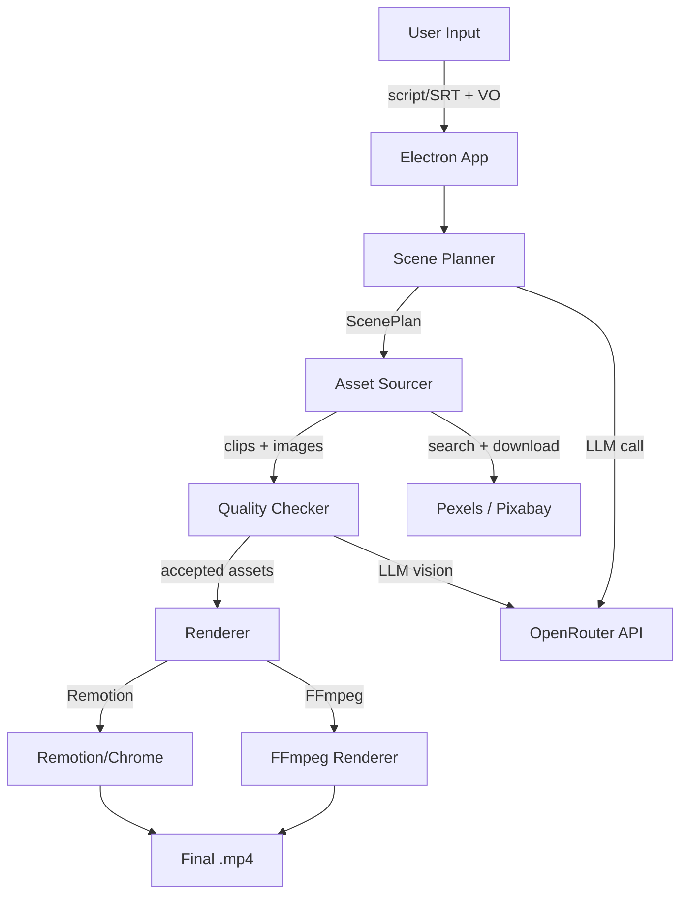

# AI Video Editor

Autonomous documentary video pipeline. Takes a script/SRT + voiceover audio, uses LLMs to plan visual beats, sources video/image assets via Pexels/Pixabay APIs, quality-checks them via vision LLMs, and renders the final video using **Remotion** or **FFmpeg**.

Available as a **macOS desktop app** (Electron).

## Architecture

## Explore

### Core
- [[Architecture]] - System design deep dive
- [[Pipeline Flow]] - Step-by-step pipeline with progress mapping
- [[Data Model]] - All TypeScript types and interfaces
- [[Configuration]] - Config system, model tiers, settings
- [[Troubleshooting]] - Known issues and fixes

### Pipeline Steps
- [[Orchestrator]] - Master pipeline controller with cancel/continue
- [[Scene Planner]] - LLM scene plan generation
- [[Asset Sourcer]] - Pexels/Pixabay API search + download with LLM query translation
- [[Quality Checker]] - Vision LLM asset validation
- [[Renderer]] - Remotion segment rendering + ffmpeg audio muxing
- [[FFmpeg Renderer]] - Native FFmpeg renderer with cancel support

### Electron App
- [[Main Process]] - App lifecycle, patches
- [[IPC Handlers]] - All IPC channels + flow
- [[Preload Bridge]] - Context bridge API
- [[Paths Service]] - Binary + directory resolution
- [[Projects Service]] - Project CRUD persistence
- [[Packaging]] - electron-builder, asar, resources

### UI Components
- [[App Component]] - Root component, state, error handling, cancel/continue UI
- [[Sidebar]] - Navigation
- [[DropZone]] - File input
- [[Model Selector]] - Model dropdowns with /hr cost labels
- [[Beat Timeline]] - Beat visualization with thumbnails
- [[Beat Editor]] - Beat property editing + candidate picker
- [[Settings]] - Settings modal (API keys, general, advanced)
- [[Log Viewer]] - Real-time logs
- [[Planning View]] - Scene plan generation progress
- [[Projects View]] - Project management
- [[Error Modal]] - Error display
- [[Progress Bar]] - Render progress

### Remotion Components
- [[Remotion Root]] - Composition registration
- [[Documentary]] - Main composition
- [[Video Clip]] - Clip playback with effects
- [[Image Slide]] - Ken Burns animation (14 directions)
- [[Title Card]] - Title cards
- [[Lower Third]] - Overlay text
- [[Motion Graphic]] - Animated graphics
- [[Transition]] - 10 transition types

### Utilities
- [[LLM Client]] - OpenRouter + retry logic
- [[FFmpeg Utils]] - Audio muxing, overlay mixing
- [[File Parser]] - Multi-format script parsing
- [[File Utils]] - FS utilities
- [[Logger]] - Timestamped logging
